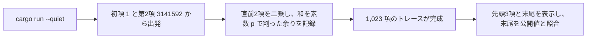
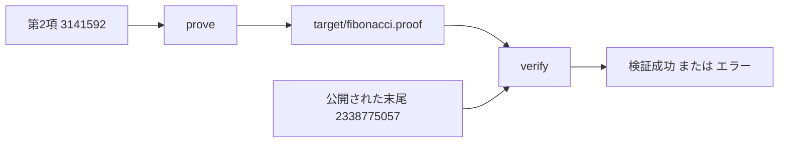
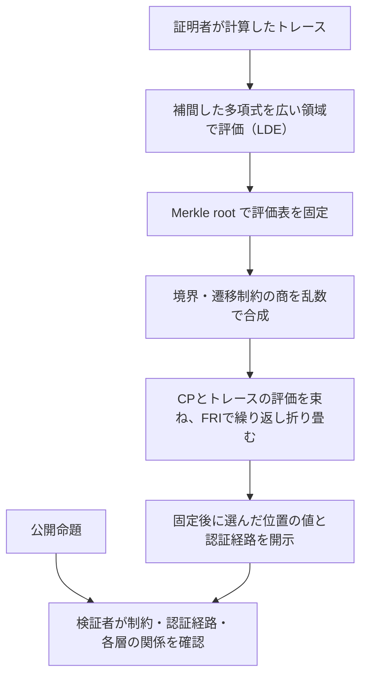

# stark-practice

STARKを学習するためのリポジトリです。最初の問いは「ある値から始めて計算を1,021回繰り返すと、指定された値に到達するか」です。まずRustで全ステップを実行して答えを確かめます。その後、検証者が全ステップを再計算せずに同じ主張を確かめられるよう、StarkWareのSTARK 101に沿って証明者と検証者を実装しています。

## 最初の実験を動かす

RustとCargoが使える環境で、リポジトリのルートから実行します。ハッシュ関数には `sha2` クレートのSHA-256を使います。

```sh
cargo run --quiet
```

```text
先頭3項 = [1, 3141592, 2986670666]
a[1022] = 2338775057
```



ここで使う数列はFibonacciSqです。普通のフィボナッチ数列に二乗が加わり、各項を有限体の素数 `p = 3 × 2³⁰ + 1 = 3221225473` で割った余りとして扱います。例えば第2項に3を選ぶと、次の2項は `1² + 3² = 10`、`3² + 10² = 109` です。実装ではそれぞれの二乗を先に有限体の要素に戻してから足し、二乗和が64ビットを超えることを防ぎます。[有限体演算](src/field.rs)・[トレース生成](src/fibonacci.rs)

スライドの公開命題は「初項が1、末尾が2338775057となる第2項が存在する」です。第2項3141592はその具体例で、証明者だけが必要とする入力（witness）に相当します。引数なしのデモでは、学習のためにその値を表示し、トレースを直接計算します。[STARK 101 Part 1](https://starkware.co/wp-content/uploads/2021/12/STARK101-Part1.pdf)

## 証明を生成して検証する

リポジトリのルートから次の2コマンドを実行します。`prove` は証明ファイルを書き出します。`verify` は別プロセスでファイルと公開値を受け取り、検証に成功すると終了コード0を返します。

```sh
cargo run --quiet --release -- prove target/fibonacci.proof
cargo run --quiet --release -- verify target/fibonacci.proof 2338775057
```



末尾を `2338775058` に変えて同じファイルを検証すると、終了コード1で拒否します。公開値は検証者がコマンドで指定し、Fiat–Shamirの履歴にも取り込みます。値が変わると問い合わせ位置も変わるため、元の認証経路は使えません。

## STARKの全体像



Merkle rootは「後から評価表を書き換えていないか」を確認するための短いハッシュ値です。それだけでは、表の値が正しい計算を表すかは分かりません。そこで計算規則を多項式の条件に変換し、FRIで評価表が低次数多項式の評価に近いかを確率的に調べます。検証者は両者を**同じ問い合わせ位置**で照合します。

### コードを読む順番

| 段階 | コード | 確かめること |
| --- | --- | --- |
| 有限体とLDE | [field.rs](src/field.rs) | `a[i] = f(g^i)` を満たす多項式をNewton補間し、8,192点で評価する |
| 制約から合成多項式へ | [fibonacci.rs](src/fibonacci.rs) | 初項・末尾・遷移の分子を、それぞれがゼロになる点に対応する積で割る |
| コミットメントとチャレンジ | [commitment.rs](src/commitment.rs) | SHA-256で評価表を固定し、公開命題とrootの履歴から乱数を導く |
| FRIと検証 | [proof.rs](src/proof.rs) | 各層で `x` と `−x` の値を折り畳み、問い合わせ先で制約と前後の層を照合する |
| ファイルとCLI | [encoding.rs](src/encoding.rs)・[main.rs](src/main.rs) | 証明を書き出し、公開パラメータから決まる構造で読み込む |

台のサイズを `N = 1024` とすると、合成多項式（CP）の目標次数は `N − 1` 以下です。トレース多項式 `f` には `N − 2` 以下を求めるため、`CP`、`f`、`X·f` を同じ上限のFRI検査に束ねます。`f` と `X·f` がともに `N − 1` 以下なら、`f` は `N − 2` 以下です。係数 `γ₀, γ₁` はCPとトレースを固定した後に導き、`CP + γ₀·f + γ₁·X·f` を最初の層にします。検証者は問い合わせ位置でこの式を再計算し、折り畳みを10回たどって最終定数と照合します。[実装計画と数学の詳細](docs/plan.md)

## 証明サイズを測る

```sh
cargo run --quiet --release -- measure
```

証明全体とMerkle認証経路のバイト数、検証9回の中央値をCSVで表示します。検証時間の計測範囲は、読み込みとデコードの後に行う暗号・代数検査です。以下は実測例で、検証時間は実行環境によって変わります。

| トレース項数 | 問い合わせ数 | 証明全体（B） | 認証経路（B） | 検証時間（µs） |
| ---: | ---: | ---: | ---: | ---: |
| 63 | 16 | 60,688 | 58,368 | 793 |
| 255 | 16 | 86,864 | 83,968 | 1,142 |
| 1,023 | 16 | 117,136 | 113,664 | 1,529 |
| 1,023 | 4 | 29,584 | 28,416 | 385 |
| 1,023 | 32 | 233,872 | 227,328 | 3,220 |

トレースが長くなると、LDEの木が深くなって1本の経路が長くなり、FRIの層も増えます。トレース長が一定なら、問い合わせが1件増えるごとに同じ数と長さの経路が追加されます。この形式では各経路を個別に格納するため、既定の例では認証経路が証明全体の約97%を占めます。

## FlashProveとの関係

AnthropicのFlashProveが証明するのは、コミット済みのモデルの重みから所定の推論結果が得られたことです。Merkle木でデータを固定し、Fiat–Shamir変換で検証者のチャレンジを導く考え方は、この教材と共通します。FlashProveの公式資料では推論の計算を扱うためにsumcheckやlookupも組み合わせています。ここで学ぶ対象はSTARK 101のFibonacciSqとFRIです。学習用の小さな有限体と公開される開示値を使う実装です。ゼロ知識化や実運用向けの安全性評価は実装範囲外です。[Anthropicの発表](https://www.anthropic.com/research/provable-inference)・[FlashProveのプロトコル仕様](https://github.com/anthropics/FlashProve/blob/main/docs/protocol.md)

## 整形とテスト

フォーマッターはrustfmtです。rustup環境で未導入の場合は `rustup component add rustfmt` で追加できます。整形規則はリポジトリ内で共有します。[設定ファイル](rustfmt.toml)

```sh
cargo fmt          # Rustコードを整形
cargo fmt --check  # ファイルを書き換えずに整形を確認
cargo test         # 数列・補間・FRI・証明の改変拒否を確認
```
